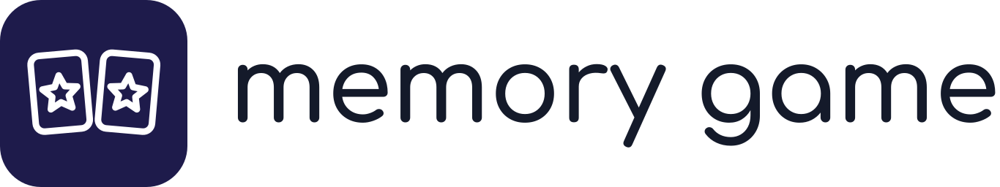
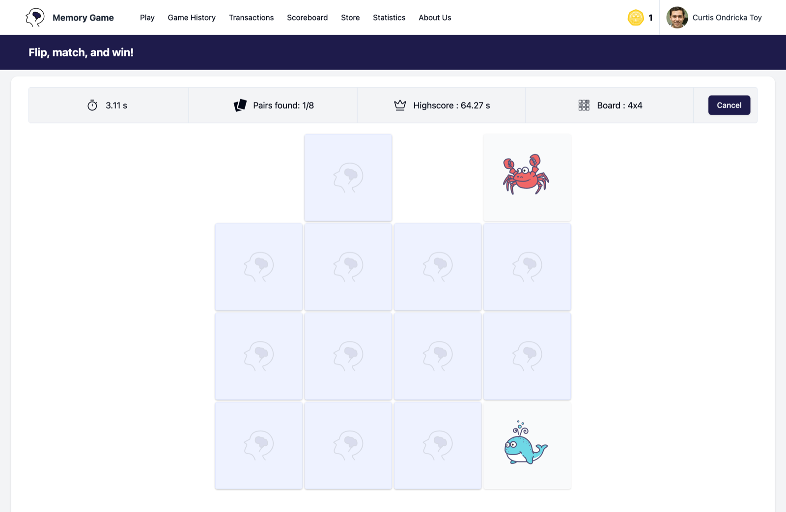
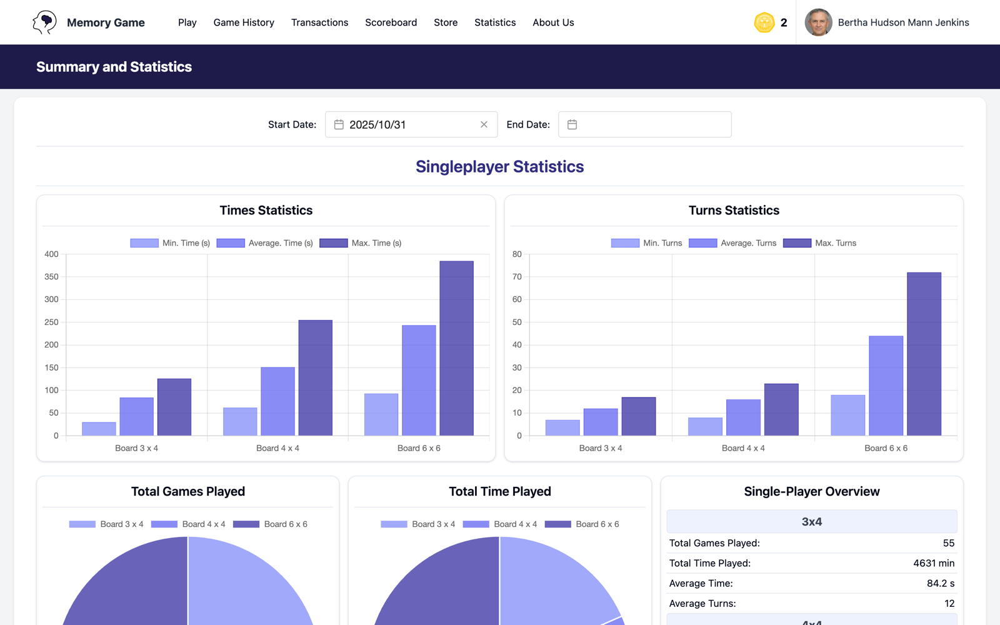
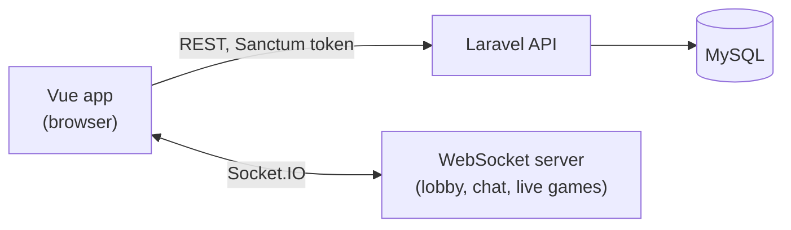

<div align="center">

<picture>
  <source media="(prefers-color-scheme: dark)" srcset="assets/logo/lockup-dark.svg">
  
</picture>

*The classic card-matching game on the web: flip cards, find the pairs, play solo or against a friend in real time*


[](LICENSE)

[Features](#features) • [Getting started](#getting-started) • [How it works](#how-it-works) • [Deployment](#deployment) • [Project structure](#project-structure)



</div>

Memory Game is a distributed web app built around the classic card-matching game. A Vue single-page app talks to a Laravel REST API for accounts, games and coins, and to a Socket.IO server for the multiplayer lobby, its chat and live games.

> [!NOTE]
> Built by Diogo Abegão, João Parreira, Marcelo Oliveira and Pedro Barbeiro (group 37) for the Distributed Applications Development course at IPLeiria, 2024-25.

## Features

- **Three boards.** 3x4 is free and open to guests; 4x4 and 6x6 cost one brain coin per game.
- **Solo play against the clock.** The timer, the pairs found and your best time on the board stay in view while you play.
- **Real-time multiplayer.** Open a game in the lobby or join one, chat with the players waiting there, then take turns on the same board. Each player pays 5 brain coins and the winner takes 7.
- **Brain coins and card decks.** Buy coins in the store with MB WAY, PayPal, IBAN, MB or Visa (checked by the course's mock payment service, so no real money moves), then spend them on eight extra card decks, from Emoji to Football. Every purchase and game fee shows up under Transactions.
- **Scoreboards and statistics.** Global and personal scoreboards, charts of your times and turns per board, and site-wide statistics.
- **Administration.** Administrators block and delete accounts, add other administrators, and see every game and transaction.



## Getting started

### Prerequisites

- Docker, for the API and the database ([Laravel Sail](https://laravel.com/docs/11.x/sail))
- PHP 8.2 or later and Composer, to install the API's dependencies
- [Bun](https://bun.sh), for the WebSocket server
- Node.js and npm, for the web app

### Run it locally

Use three terminals, one per service.

**1. API and database** (API on port 8085, MySQL on 3306):

```bash
cd laravel
composer install
./vendor/bin/sail up -d
./vendor/bin/sail artisan migrate:fresh --seed
./vendor/bin/sail artisan storage:link
```

The seeder asks which language to use for the generated names; press Enter for English. It fills the database with users, games and transactions, so the scoreboards and statistics have data from the start.

**2. WebSocket server** (port 8086):

```bash
cd websockets
bun install
bun run dev
```

**3. Web app**:

```bash
cd vue
npm install
npm run dev
```

Open <http://localhost:5173> and log in with a seeded account:

| Account | Email | Password |
| --- | --- | --- |
| Player | `p1@mail.pt` | `123` |
| Administrator | `a1@mail.pt` | `123` |

> [!TIP]
> The web app reads the API and WebSocket addresses from `vue/.env` (`VITE_API_DOMAIN`, `VITE_WS_CONNECTION`). Change them there if you run a service on another port.

## How it works



- **Laravel API** (`laravel/`): accounts and Sanctum tokens, boards, games, transactions, scoreboards and statistics.
- **WebSocket server** (`websockets/`): keeps the lobby, its chat and the multiplayer games in memory and relays each move to both players. It has no database; the web app saves results through the API.
- **Vue app** (`vue/`): Vue 3, Vite, Pinia, Tailwind CSS and Chart.js.

## Deployment

The `justfile` builds the three Docker images from `deployment/`, pushes them to the course's registry and applies the Kubernetes manifests:

```bash
just laravel-build && just laravel-push
just vue-build && just vue-push
just ws-build && just ws-push
just deploy
```

The registry address and the namespace (`dad-group-37`) point at the course's cluster; change them in the `justfile` and in `deployment/` to deploy elsewhere.

## Project structure

| Path | Contents |
| --- | --- |
| `laravel/` | REST API: controllers, migrations and seeders |
| `vue/` | Web app: pages, Pinia stores, card decks in `public/decks/` |
| `websockets/` | Socket.IO server: lobby and multiplayer game engine |
| `deployment/` | Dockerfiles and Kubernetes manifests |
| `bruno_collection/` | API requests for [Bruno](https://www.usebruno.com), one folder per resource |
| `project/` | The course brief and the group's intermediate report |
| `justfile` | Build, push and deploy commands |
| `docs/images/` | Screenshots for this README |
